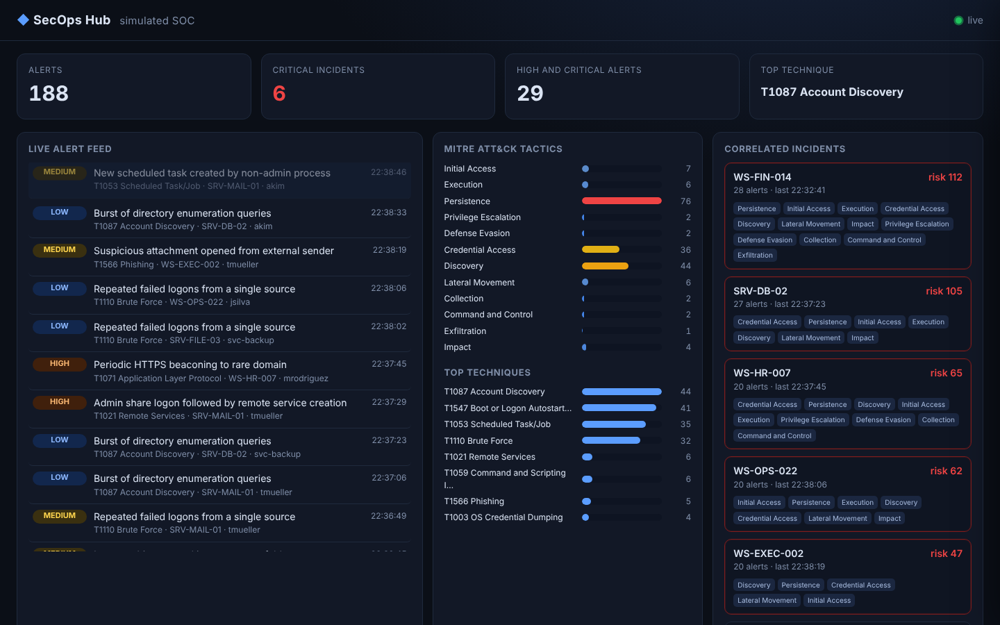
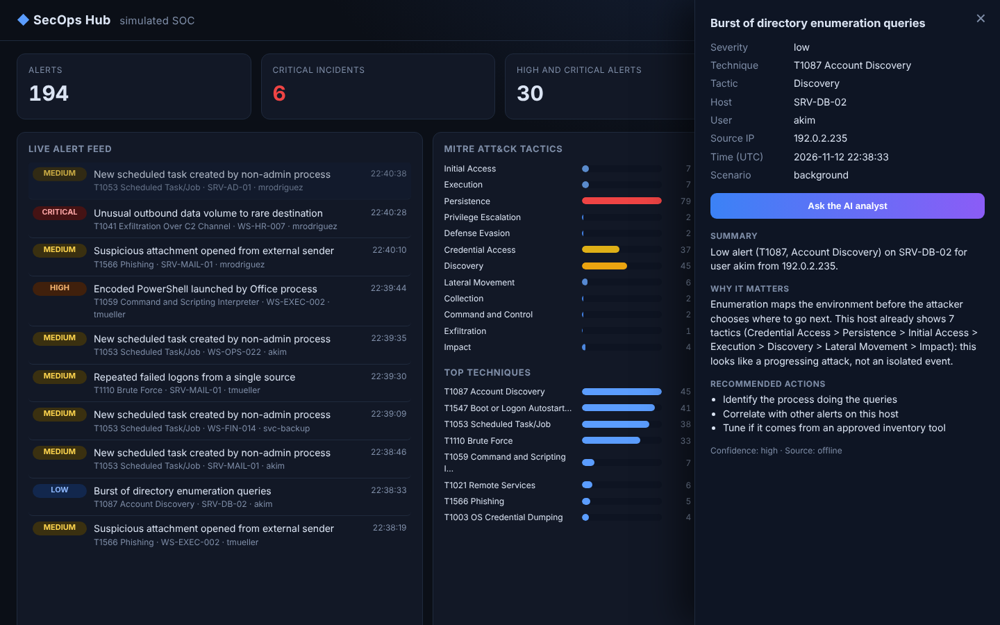

# SecOps Hub

A live, simulated Security Operations Center in a **single Go binary** with zero dependencies. A deterministic attack simulator feeds a real-time dashboard: alerts stream in over Server-Sent Events, are mapped to MITRE ATT&CK, correlated into per-host incidents, and explained by an **AI analyst** (Claude through the Anthropic API, or a built-in offline knowledge base when no key is set).

> Built with AI assistance (Claude) as part of a security portfolio. Everything is synthetic: hosts, users and IP addresses (RFC 5737 documentation ranges) are fictional.





## Run it

```bash
go run ./cmd/secops-hub            # http://127.0.0.1:8080
go run ./cmd/secops-hub -seed 7 -every 300ms

# optional: richer explanations from Claude
ANTHROPIC_API_KEY=... go run ./cmd/secops-hub
```

Same `-seed`, same attack story, which makes demos repeatable. The server binds to loopback by default because this is a demo, not a hardened product.

## What you are looking at

- **Live feed**: alerts stream in through `EventSource`; click one to open the detail drawer.
- **ATT&CK tactics heat bars**: all 12 tactics in kill-chain order, colour scaled from blue to red.
- **Correlated incidents**: alerts are grouped per host. An incident turns **critical** only with real signal: at least one high or critical alert plus either four distinct tactics (a progressing chain) or a large accumulated score. Low-severity background noise alone never qualifies.
- **Attack scenarios**: phishing to ransomware, web exploit to exfiltration, credential stuffing, each a realistic ordered chain of ATT&CK techniques running alongside noise.
- **AI analyst**: summary, why it matters (with incident context), three response actions and a confidence level.

## Architecture

```
sim.Generator --> hub.Hub --+--> /events   (SSE, non-blocking fan-out)
 (seeded, chains)  |  ring  +--> /api/stats, /api/alerts
                   |  buffer+--> /api/explain --> analyst (Claude or offline fallback)
                   +-- per-host incident correlation
embedded static UI (no inline script or style, no external origin)
```

| Package | Responsibility |
|---|---|
| `internal/sim` | Deterministic alert generator with attack campaigns mapped to ATT&CK |
| `internal/hub` | Ring buffer, counters, incident correlation, slow-consumer-safe pub/sub |
| `internal/analyst` | Offline ATT&CK knowledge base and Claude client with graceful fallback |
| `internal/server` | HTTP API, SSE stream, embedded UI, security headers |

## Security design

- **Strict CSP** (`default-src 'self'`), `nosniff`, `no-referrer`, `frame-ancestors 'none'`. The UI has no inline script or style, and renders every alert field with `textContent`, so alert text can never become markup.
- **Prompt-injection aware**: alert fields are untrusted data. The Claude prompt says so explicitly, asks for JSON only, and the response is parsed and validated. Anything unparseable, an HTTP error, a timeout or a missing key falls back to the offline analyst, and the UI shows which source answered.
- **No blocking on slow clients**: a stalled browser tab cannot stall the pipeline, because the hub drops events for full subscriber buffers.
- With a key set, alert fields are sent to the Anthropic API. Here they are synthetic; with real data, review your data handling policy first.

## API

| Endpoint | Description |
|---|---|
| `GET /api/stats` | Totals, severity counts, tactics, top techniques, incidents |
| `GET /api/alerts?limit=50` | Newest alerts first (max 200) |
| `POST /api/explain?id=N` | AI analyst explanation for alert N (404 once it ages out of the 500 alert buffer) |
| `GET /events` | Server-Sent Events stream of new alerts |

## Tests

```bash
go test -race ./...
```

Covers seed determinism and scenario ordering, documentation-range IPs, correlation and critical rules, ring buffer limits, slow-consumer safety, the Claude client against a fake API (request shape, five failure modes, nil client), every HTTP endpoint with status codes, security headers and a live SSE round trip. CI runs on Linux, macOS and Windows.

MIT licensed.
